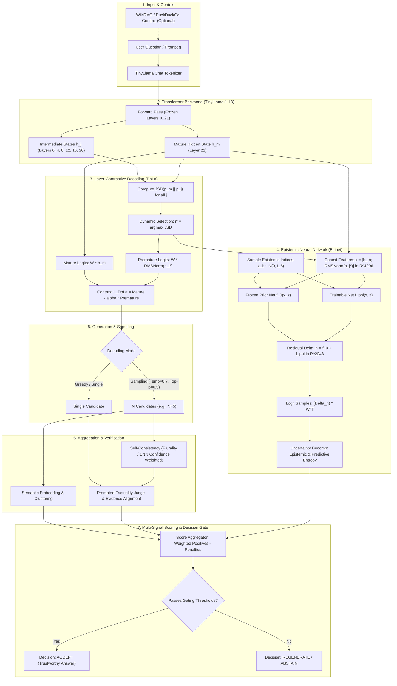

# DoLa + ENN Reliability Pipeline for Small Language Models

> **Research codebase and interactive console for TinyLlama-1.1B inference combining Decoding by Contrasting Layers (DoLa), Epistemic Neural Networks (Epinet), Self-Consistency Voting, and Multi-Signal Hallucination Gating.**

---

## Contents

- [Overview & Core Contributions](#overview--core-contributions)
- [System Architecture](#system-architecture)
- [Mathematical Formulations](#mathematical-formulations)
  - [1. Layer-Contrastive Decoding (DoLa)](#1-layer-contrastive-decoding-dola)
  - [2. Epistemic Neural Network (Epinet) Architecture & Loss](#2-epistemic-neural-network-epinet-architecture--loss)
  - [3. Uncertainty Quantification & Decomposition](#3-uncertainty-quantification--decomposition)
  - [4. Self-Consistency & Confidence-Weighted Voting](#4-self-consistency--confidence-weighted-voting)
  - [5. Multi-Signal Answer Scoring & Abstention Gating](#5-multi-signal-answer-scoring--abstention-gating)
  - [6. Calibration & Evaluation Metrics](#6-calibration--evaluation-metrics)
- [Step-by-Step Execution Workflows](#step-by-step-execution-workflows)
  - [Pipeline 1: Offline Feature Extraction & Epinet Training](#pipeline-1-offline-feature-extraction--epinet-training)
  - [Pipeline 2: Runtime Inference (Base, DoLa, DoLa + ENN)](#pipeline-2-runtime-inference-base-dola-dola--enn)
  - [Pipeline 3: Self-Consistency Experiments](#pipeline-3-self-consistency-experiments)
  - [Pipeline 4: Multi-Signal Verification & Factuality Review](#pipeline-4-multi-signal-verification--factuality-review)
  - [Pipeline 5: Interactive Web Console (Streamlit UI)](#pipeline-5-interactive-web-console-streamlit-ui)
- [Download and Install](#download-and-install)
- [Model, Data, and Checkpoint Assets](#model-data-and-checkpoint-assets)
- [CLI Reference & Evaluation Modes](#cli-reference--evaluation-modes)
- [Archived Benchmark Results & Findings](#archived-benchmark-results--findings)
- [Configuration and Outputs](#configuration-and-outputs)
- [Project Layout](#project-layout)
- [Troubleshooting & FAQ](#troubleshooting--faq)
- [References](#references)

---

## Overview & Core Contributions

Small language models optimize continuation likelihood rather than factual correctness, which often leads to fluent but unsupported hallucinations. Softmax output probabilities are notoriously overconfident and uncalibrated to answer-level truth.

This repository decouples **hallucination mitigation at generation** from **post-generation detection and abstention**:
1. **Contrastive Decoding (DoLa):** Contrasts deeper transformer layers against dynamically selected intermediate layers to amplify emerging factual knowledge without fine-tuning.
2. **Epistemic Uncertainty Estimation (Epinet):** Augments the frozen transformer representations with a sampled epistemic variable $z \sim \mathcal{N}(0, I)$, disentangling aleatoric data noise from epistemic model uncertainty.
3. **Candidate Sampling & Consensus (Self-Consistency):** Generates candidate answers and applies plurality or ENN-entropy-weighted voting.
4. **Multi-Signal Answer Scoring & Abstention Gating:** Combines token confidence, semantic consistency, factuality review, and RAG evidence to decide whether to **ACCEPT** an answer or **REGENERATE / ABSTAIN**.

---

## System Architecture



---

## Mathematical Formulations

### 1. Layer-Contrastive Decoding (DoLa)

Let $h_t^l \in \mathbb{R}^d$ ($d=2048$) denote the hidden state at layer $l \in \{0, \dots, 21\}$ for token position $t$. Let $W \in \mathbb{R}^{|V| \times d}$ denote the language model head matrix ($|V| = 32{,}000$).

**Intermediate Layer Logits**:

$$
\ell_t^j = W \cdot \mathrm{RMSNorm}(h_t^j), \qquad p_t^j = \mathrm{softmax}(\ell_t^j)
$$

**Mature Layer Logits** (Layer $m=21$; already post-RMSNorm in TinyLlama):

$$
\ell_t^m = W \cdot h_t^m, \qquad p_t^m = \mathrm{softmax}(\ell_t^m)
$$

**Jensen-Shannon Divergence (JSD)**:

$$
\mathrm{JSD}(p_t^m \parallel p_t^j) = \frac{1}{2} D_{\mathrm{KL}}(p_t^m \parallel M_t^j) + \frac{1}{2} D_{\mathrm{KL}}(p_t^j \parallel M_t^j)
$$

where $M_t^j = \frac{1}{2}(p_t^m + p_t^j)$ and $D_{\mathrm{KL}}(P \parallel Q) = \sum_{v \in V} P(v) \log \frac{P(v)}{Q(v)}$.

**Dynamic Premature Layer Selection**:

$$
j_t^* = \arg\max_{j \in \mathcal{J}} \mathrm{JSD}(p_t^m \parallel p_t^j), \qquad \mathcal{J} = \{0, 4, 8, 12, 16, 20\}
$$

**Contrastive Logits & Distribution**:

$$
\ell_t^{D} = \ell_t^m - \alpha \cdot \ell_t^{j_t^*}
$$

$$
p_t^D = \mathrm{softmax}(\ell_t^D)
$$

*(Active default hyperparameter: $\alpha = 0.05$ or $1.0$ depending on experiment configuration).*

---

### 2. Epistemic Neural Network (Epinet) Architecture & Loss

The Epinet models parameter/epistemic uncertainty via an epistemic index vector $z \sim \mathcal{N}(0, I_{d_z})$ with dimension $d_z = 6$.

**Input Representation**:

$$
x_t = \left[ h_t^m \; ; \; \mathrm{RMSNorm}(h_t^{j_t^*}) \right] \in \mathbb{R}^{2d} = \mathbb{R}^{4096}
$$

**Frozen Prior Network $f_0(x, z)$**:

$$
g_0(x) = \mathrm{Linear}_{512 \to (2048 \times 6)}\Big(\mathrm{ReLU}\big(\mathrm{Linear}_{512 \to 512}(\mathrm{ReLU}(\mathrm{Linear}_{4096 \to 512}(x)))\big)\Big)
$$

$$
f_0(x, z) = \mathrm{Reshape}(g_0(x), [2048, 6]) \cdot z \in \mathbb{R}^{2048}
$$

*Parameters of $f_0$ are randomly initialized and permanently frozen ($\nabla_\theta f_0 = 0$).*

**Trainable Residual Network $f_\phi(x, z)$**:

$$
g_\phi(x) = \mathrm{Linear}_{512 \to (2048 \times 6)}\Big(\mathrm{ReLU}\big(\mathrm{Linear}_{512 \to 512}(\mathrm{ReLU}(\mathrm{Linear}_{4096 \to 512}(x)))\big)\Big)
$$

$$
f_\phi(x, z) = \mathrm{Reshape}(g_\phi(x), [2048, 6]) \cdot z \in \mathbb{R}^{2048}
$$

**Combined Epinet Residual**:

$$
\Delta h(x_t, z) = f_0(x_t, z) + f_\phi(x_t, z)
$$

**Training Loss (Sampled Cross-Entropy on C4)**:

For $K$ Monte Carlo index draws $z_1, \dots, z_K \sim \mathcal{N}(0, I_6)$:

$$
\mathcal{L}(\phi) = \frac{1}{|\mathcal{D}| K} \sum_{(x_t, y_t) \in \mathcal{D}} \sum_{k=1}^K \mathrm{CrossEntropy}\left( \ell_t^D + W \cdot [f_0(x_t, z_k) + f_\phi(x_t, z_k)], \; y_t \right)
$$

---

### 3. Uncertainty Quantification & Decomposition

Given an input representation $x$ and $K$ epistemic index draws $z_k$:

**Sample Logits & Probability Vectors**:

$$
\ell^{(k)} = \ell^D + W \cdot \Delta h(x, z_k), \qquad p^{(k)} = \mathrm{softmax}(\ell^{(k)}) \in \Delta^{|V|-1}
$$

**Mean Predictive Distribution**:

$$
\bar{p} = \frac{1}{K} \sum_{k=1}^K p^{(k)}
$$

**Total Predictive Uncertainty (Entropy of the Mean)**:

$$
\mathcal{H}_{\mathrm{pred}} = H(\bar{p}) = -\sum_{v \in V} \bar{p}(v) \log \bar{p}(v)
$$

**Aleatoric Uncertainty (Mean of Entropies / Data Noise)**:

$$
\mathcal{H}_{\mathrm{alea}} = \mathbb{E}_z [H(p^{(k)})] = \frac{1}{K} \sum_{k=1}^K \left( -\sum_{v \in V} p^{(k)}(v) \log p^{(k)}(v) \right)
$$

**Epistemic Uncertainty (Mutual Information $I(Y; Z \mid X)$ / Model Ignorance)**:

$$
\mathcal{U}_{\mathrm{epi}} = \max\left(0, \; H(\bar{p}) - \frac{1}{K} \sum_{k=1}^K H(p^{(k)})\right)
$$

---

### 4. Self-Consistency & Confidence-Weighted Voting

Given $N$ candidate answers $\{a_1, a_2, \dots, a_N\}$ sampled at temperature $T=0.7$, top-$p=0.9$:

**Answer Normalization**:

$$
\tilde{a}_i = \mathrm{Normalize}(\mathrm{ExtractFinalAnswer}(a_i))
$$

**Plurality Voting**:

$$
v(c) = \sum_{i=1}^N \mathbb{1}[\tilde{a}_i = c], \qquad c^* = \arg\max_c v(c)
$$

**ENN Confidence-Weighted Voting**:

For candidate $i$ spanning answer tokens $t \in \{1, \dots, T_i\}$, the average predictive entropy is $\bar{H}_i = \frac{1}{T_i} \sum_{t=1}^{T_i} H(\bar{p}_{i, t})$.
The heuristic confidence weight $w_i \in [0, 1]$ is:

$$
w_i = \mathrm{clip}\left(1 - \frac{\bar{H}_i}{\log |V|}, \; 0, \; 1\right)
$$

Weighted score for cluster $c$:

$$
S(c) = \sum_{i: \tilde{a}_i = c} w_i, \qquad c^* = \arg\max_c S(c)
$$

Normalized vote confidence:

$$
\mathrm{Conf}(c^*) = \frac{S(c^*)}{\sum_k S(c_k)}
$$

---

### 5. Multi-Signal Answer Scoring & Abstention Gating

Implemented in `Neural Network/answer_selector.py`:

**Positive Score Aggregation**:

$$
S_{\mathrm{pos}} = \frac{\sum_{m \in \mathcal{M}} w_m \cdot v_m}{\sum_{m \in \mathcal{M}} w_m}
$$

*Default Positive Weights $w_m$:*
- Factuality Score: $0.24$
- Semantic Consistency: $0.22$
- Reliability Probability: $0.16$
- Claim Support: $0.10$
- Token Confidence: $0.08$
- Relevance Score: $0.08$
- Evidence Support Score: $0.08$
- Sequence Probability: $0.04$

**Penalty Aggregation**:

$$
P = \sum_{p \in \mathcal{P}} \lambda_p \cdot r_p
$$

*Default Penalty Weights $\lambda_p$:*
- Hallucination Score: $0.22$
- Contradiction Score: $0.20$
- Unsupported Claim: $0.14 \times (1 - \mathrm{claim\_support})$
- Unsupported Evidence: $0.10 \times (1 - \mathrm{evidence\_support})$
- High Entropy: $0.06 \times \mathrm{entropy\_penalty}$

**Composite Candidate Score**:

$$
S_{\mathrm{final}} = \mathrm{clip}(S_{\mathrm{pos}} - P, \; 0, \; 1)
$$

**Abstention Gating Criteria**:

An answer candidate is **ACCEPTED** only if:

$$
\begin{aligned}
S_{\mathrm{final}} &\ge \tau_{\mathrm{reliability}} \quad (\text{default } 0.55) \\
\text{Semantic Consistency} &\ge \tau_{\mathrm{consistency}} \quad (\text{default } 0.40) \\
\text{Factuality Score} &\ge \tau_{\mathrm{factuality}} \quad (\text{default } 0.45) \\
\text{Hallucination Score} &\le \tau_{\mathrm{hallucination}} \quad (\text{default } 0.55)
\end{aligned}
$$

If any gate fails, the decision is **REGENERATE** (abstain and request fresh generation).

---

### 6. Calibration & Evaluation Metrics

For $N$ evaluated examples partitioned into $B$ confidence bins $B_1, \dots, B_B$:

**Expected Calibration Error (ECE)**:

$$
\mathrm{ECE} = \sum_{b=1}^B \frac{|B_b|}{N} |\mathrm{acc}(B_b) - \mathrm{conf}(B_b)|
$$

**Brier Score**:

$$
\mathrm{BS} = \frac{1}{N} \sum_{i=1}^N (c_i - y_i)^2
$$

**Negative Log-Likelihood (NLL)**:

$$
\mathrm{NLL} = -\frac{1}{N} \sum_{i=1}^N \left( y_i \log c_i + (1 - y_i) \log(1 - c_i) \right)
$$

**False Accept Rate (FAR) & False Reject Rate (FRR)**:

$$
\mathrm{FAR} = \frac{\mathrm{FP}}{\mathrm{FP} + \mathrm{TN}}, \qquad \mathrm{FRR} = \frac{\mathrm{FN}}{\mathrm{TP} + \mathrm{FN}}
$$

---

## Step-by-Step Execution Workflows

### Pipeline 1: Offline Feature Extraction & Epinet Training

```bash
# Step 1: Extract C4 mature and premature hidden states into cache
python main.py --mode extract --n-c4 20

# Step 2: Train Epinet learnable branch on C4 next-token prediction
python main.py --mode train --n-c4 20 --epochs 2 --batch-size 1
```
*What happens:*
1. `Neural Network/data_prep.py` streams texts from `allenai/c4`.
2. For each document, TinyLlama computes layer 21 ($h_m$) and selects $j^* \in \{0, 4, 8, 12, 16, 20\}$ using JSD.
3. Extracted features are post-normalized via RMSNorm and saved to `Neural Network/features_cache.npz`.
4. `Neural Network/enn_torch.py` loads the cache, trains the learnable residual $f_\phi$ with AdamW and ReduceLROnPlateau, and saves `checkpoints/enn_best.pt`.

---

### Pipeline 2: Runtime Inference (Base, DoLa, DoLa + ENN)

```bash
# Evaluate Base, DoLa, and DoLa + ENN on TruthfulQA MC1/MC2
python main.py --mode eval --n-questions 10

# Baseline only
python main.py --mode eval --no-dola --no-enn --n-questions 10

# DoLa only
python main.py --mode eval --no-baseline --no-enn --n-questions 10

# DoLa + ENN with logit blending
python main.py --mode eval --no-baseline --no-dola --enn-weight 0.1 --n-questions 10
```
*What happens:*
1. For each prompt, `Neural Network/dola.py` selects $j_t^*$ dynamically per token.
2. The contrastive distribution $p_t^D = \mathrm{softmax}(W h_t^m - \alpha W \mathrm{RMSNorm}(h_t^{j^*}))$ is decoded.
3. If ENN is active, sampled residuals $\Delta h(x_t, z_k)$ provide token predictive and epistemic uncertainty diagnostics.

---

### Pipeline 3: Self-Consistency Experiments

```bash
# Run all Self-Consistency ablations across candidate sample counts (1, 3, 5, 10)
python run_experiment.py --strategy all --samples 1 3 5 10

# Run DoLa plurality Self-Consistency
python run_experiment.py --strategy dola_self_consistency --samples 5

# Run DoLa + ENN confidence-weighted Self-Consistency
python run_experiment.py --strategy dola_enn_self_consistency --samples 5
```
*What happens:*
1. $N$ candidates are sampled per question ($T=0.7, p=0.9$).
2. Candidate answers are normalized (`Neural Network/self_consistency.py`).
3. For ENN-weighted voting, candidate predictive entropy is computed across tokens and converted into confidence weights $w_i = \mathrm{clip}(1 - \bar{H}_i/\log|V|, 0, 1)$.
4. Results, calibration curves, ECE, and confusion breakdowns are saved to `results/`.

---

### Pipeline 4: Multi-Signal Verification & Factuality Review

```bash
# Interactive question answering with full multi-signal verification
source llm_hallucination_env/bin/activate
python main.py --mode ask --sc-samples 5 --max-new-tokens 48 --verbose
```
*What happens:*
1. Generates Base, DoLa, and Self-Consistency candidate pools.
2. `Neural Network/semantic_consistency.py` mean-pools hidden states and clusters answers at cosine threshold $0.78$.
3. (Optional `--use-rag`): `Neural Network/rag.py` retrieves evidence passages from local Qdrant or DuckDuckGo.
4. `Neural Network/factuality.py` prompts the model as an objective factuality judge, extracting structured JSON metrics.
5. `Neural Network/answer_selector.py` evaluates gates and issues an `ACCEPT` or `REGENERATE` verdict.

---

### Pipeline 5: Interactive Web Console (Streamlit UI)

```bash
# Launch the interactive Streamlit Web Console
python run_web.py --port 8501
```
*Features:*
- Visual side-by-side comparison of Base, DoLa, DoLa + ENN, and Self-Consistency.
- Token-by-token premature layer selection inspection.
- Real-time gauges for predictive, aleatoric, and epistemic uncertainty.
- Evidence drawer displaying retrieved Wikipedia and web snippets.
- Detailed score breakdown showing positive contributions, applied penalties, and the final gating verdict.

---

## Download and Install

### 1. Clone repository
```bash
git clone https://github.com/ganeshedula/capstone.git
cd capstone
```

### 2. Set up environment
```bash
python3 -m venv .venv
source .venv/bin/activate       # macOS / Linux
# .venv\Scripts\activate       # Windows PowerShell
python -m pip install --upgrade pip
python -m pip install -r requirements.txt
```

### 3. Download TinyLlama-1.1B
```bash
python -m pip install -U huggingface_hub
hf download TinyLlama/TinyLlama-1.1B-Chat-v1.0 \
  --local-dir models/TinyLlama-1.1B-Chat-v1.0
```

### 4. Verify environment
```bash
python Verification/verify_pytorch.py
```

---

## Model, Data, and Checkpoint Assets

| Asset | How it is obtained | Needed for |
| :--- | :--- | :--- |
| **TinyLlama-1.1B** | Hugging Face Hub download into `models/TinyLlama-1.1B-Chat-v1.0/` | All inference, decoding, and evaluation |
| **C4 Dataset** | Streamed via `allenai/c4` (Hugging Face Datasets) | Feature extraction and Epinet training |
| **TruthfulQA** | Loaded automatically via `datasets` package | Multiple-choice MC1/MC2 evaluations |
| **`eval_questions.json`** | Included in repository | Local testing and Self-Consistency ablations |
| **`features_cache.npz`** | Generated via `python main.py --mode extract` | Epinet offline training |
| **`checkpoints/enn_best.pt`** | Generated via `python main.py --mode train` | ENN inference, evaluation, and uncertainty scoring |

---

## CLI Reference & Evaluation Modes

| Command | Action |
| :--- | :--- |
| `python main.py` | Full pipeline: extract C4 features $\to$ train Epinet $\to$ evaluate TruthfulQA |
| `python main.py --mode extract` | Extract C4 DoLa hidden states and build `features_cache.npz` |
| `python main.py --mode train` | Train PyTorch Epinet and write `checkpoints/enn_best.pt` |
| `python main.py --mode eval` | Benchmark Base, DoLa, and DoLa + ENN on TruthfulQA |
| `python main.py --mode dola-sweep` | Sweep contrastive $\alpha \in [0.05, 1.0]$ and fixed premature layers |
| `python main.py --mode ablation` | Sweep ENN logit weights to measure logit blending impact |
| `python main.py --mode ask` | Interactive terminal console with semantic consistency & fact checking |
| `python main.py --mode before-after` | Custom question evaluation before and after Epinet training |
| `python main.py --mode c4-eval` | Token-level perplexity and loss evaluation on held-out C4 texts |
| `python run_experiment.py` | Run Base / DoLa / SC / ENN Self-Consistency comparison suite |
| `python run_web.py` | Launch the Streamlit interactive visualization console |

---

## Archived Benchmark Results & Findings

Empirical findings from the 211-example held-out benchmark (169 TruthfulQA + 42 HaluEval-QA examples; 54 reliable / 157 unreliable ground-truth labels) documented in `research_paper/main.tex`:

| Method | Accuracy | Balanced Acc. | Precision | Recall | F1 | AUROC | ECE | FAR (False Accept) | FRR (False Reject) |
| :--- | :---: | :---: | :---: | :---: | :---: | :---: | :---: | :---: | :---: |
| **Base TinyLlama (E0)** | 28.4% | 50.1% | 25.6% | **94.4%** | 40.3% | 55.4% | 45.8% | 94.3% | **5.6%** |
| **TinyLlama + DoLa (E5)** | 29.9% | 48.6% | 25.0% | 87.0% | 38.8% | 57.1% | 39.5% | 89.8% | 13.0% |
| **DoLa + SC (E6)** | 65.4% | 56.7% | 34.4% | 38.9% | 36.5% | 57.1% | 20.7% | 25.5% | 61.1% |
| **DoLa + ENN-V2 (E5b)** | 76.8% | 58.3% | 64.7% | 20.4% | 31.0% | 61.8% | **12.3%** | **3.8%** | 79.6% |
| **DoLa + ENN-V2 + SC (E7)** | 76.8% | 58.3% | 64.7% | 20.4% | 31.0% | 61.8% | **12.3%** | **3.8%** | 79.6% |
| **2048-D ENN Alone (E2-B)** | **78.2%** | **60.4%** | **72.2%** | 24.1% | 36.1% | **69.1%** | 11.6% | 3.2% | 75.9% |
| **Complete Combined** | 72.5% | 62.7% | 46.0% | 42.6% | **44.2%** | 67.0% | 19.5% | 17.2% | 57.4% |

### Key Scientific Insights:
1. **Low False Accept Rate (FAR):** While Base TinyLlama accepts 94.3% of incorrect outputs, conservative DoLa + ENN reduces false acceptance to **3.8%** (operating as a high-specificity safety gate).
2. **Representation Dominance:** The 2048-dimensional intermediate hidden representation provides the strongest ranking signal (AUROC 0.691), heavily outperforming superficial token probability heuristics.
3. **Abstention vs. Correction:** The pipeline excels at **detecting unreliability and abstaining**, rather than universally preventing incorrect token generation.

---

## Configuration and Outputs

Key configurations are managed in `config.yaml`:
```yaml
model:
  path: "models/TinyLlama-1.1B-Chat-v1.0"
training:
  n_c4_samples: 20
  batch_size: 1
  epochs: 2
  learning_rate: 0.0001
  enn_hidden_dim: 512
  epistemic_index_dim: 6
  n_z_samples: 3
dola:
  alpha: 0.05
  mature_layer: 21
  candidate_layers: [0, 4, 8, 12, 16, 20]
evaluation:
  n_questions: 10
  enn_weight: 0.0
rag:
  qdrant_url: "http://localhost:6333"
  collection: "wikipedia"
  expand_context: true
```

---

## Project Layout

```text
├── main.py                         # Main CLI: feature extraction, training, evaluation, sweeps
├── run_experiment.py               # Self-Consistency and ablation benchmark runner
├── run_web.py                      # Interactive Streamlit Web Console launcher
├── config.yaml                     # Pipeline configuration defaults
├── eval_questions.json             # Labeled local test questions
├── requirements.txt                # Python dependencies
├── Model_load/
│   ├── load_llama2.py              # Active TinyLlama loader and chat template builder
│   └── load_llama.py               # Legacy model loader
├── Neural Network/
│   ├── dola.py                     # DoLa JSD computation, layer selection, contrastive logits
│   ├── enn_torch.py                # Active PyTorch Epinet module, training loop, uncertainty decomposition
│   ├── reliability_enn.py          # Answer-level epistemic reliability network
│   ├── self_consistency.py         # Plurality and confidence-weighted voting
│   ├── semantic_consistency.py     # Answer embedding and connected-component clustering
│   ├── answer_selector.py          # Multi-signal scoring, penalty application, abstention gating
│   ├── factuality.py               # Prompted LLM-as-a-judge factuality reviewer
│   ├── claim_verifier.py           # Atomic claim extraction and evidence verification
│   ├── rag.py                      # WikiRag Qdrant and DuckDuckGo evidence retriever
│   ├── inference.py                # Autoregressive decoding and candidate sampling
│   ├── data_prep.py                # C4 dataset streaming and feature extraction cache builder
│   ├── evaluate.py                 # TruthfulQA MC1/MC2 benchmark evaluator
│   ├── c4_eval.py                  # Held-out C4 token loss evaluation
│   └── *_plots.py                  # Visualization generators
├── web/
│   ├── app.py                      # Streamlit interactive web dashboard
│   ├── ui_helpers.py               # UI rendering helpers and gauges
│   └── custom.css                  # Custom styling for the web console
├── Verification/                   # PyTorch, CUDA/MPS, and dataset environment checks
└── research_paper/                 # IEEE conference paper draft, LaTeX source, and figures
```

---

## Troubleshooting & FAQ

- **`models/TinyLlama-1.1B-Chat-v1.0` missing:** Ensure you have downloaded the weights using the Hugging Face CLI command in the setup instructions.
- **`enn_best.pt` not found:** Run `python main.py --mode train` to generate the active PyTorch Epinet checkpoint.
- **Legacy JAX Checkpoint:** `Neural Network/enn_checkpoint.pkl` is a legacy artifact; the active PyTorch pipeline expects `.pt` checkpoints created by `enn_torch.py`.
- **MPS / CUDA Acceleration:** On Apple Silicon or NVIDIA GPUs, device selection is automatic (`cuda` $\to$ `mps` $\to$ `cpu`). Check your hardware using `python Verification/verify_pytorch.py`.
- **RAG Dependencies:** To enable Qdrant and web search features, ensure `langchain_huggingface`, `qdrant-client`, and `ddgs` are installed via `requirements.txt`.

---

## References

1. Chuang et al., [DoLa: Decoding by Contrasting Layers Improves Factuality in Large Language Models](https://arxiv.org/abs/2309.03883), ICLR 2024.
2. Osband et al., [Epistemic Neural Networks](https://arxiv.org/abs/2107.08924), NeurIPS 2021.
3. Wang et al., [Self-Consistency Improves Chain of Thought Reasoning in Language Models](https://arxiv.org/abs/2203.11171), ICLR 2023.
4. Lin et al., [TruthfulQA: Measuring How Models Mimic Human Falsehoods](https://arxiv.org/abs/2109.07958), ACL 2022.
5. Zhang et al., [TinyLlama: An Open-Source Small Language Model](https://arxiv.org/abs/2401.02385), 2024.
